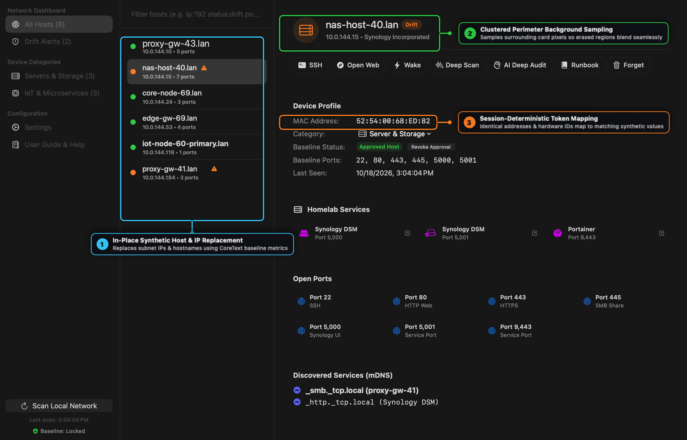
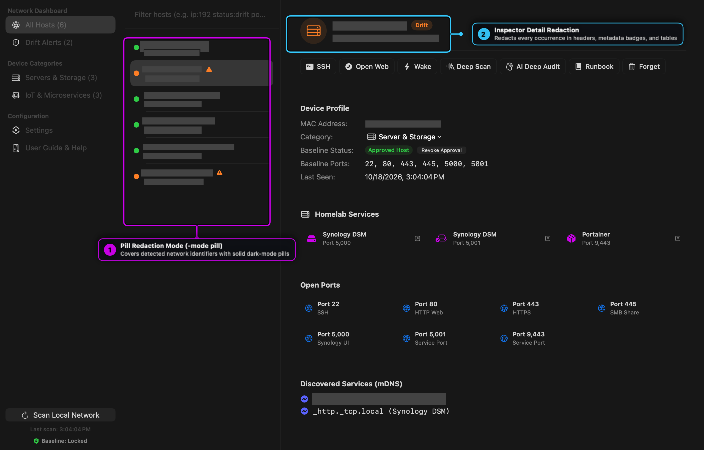

# Anonymark User Guide & Visual Walkthrough

**Anonymark** (`anonymark`) is a native Go and macOS Vision/CoreText CLI utility for capturing and anonymizing technical screenshots with **pixel-matched synthetic data replacement**. Instead of obscuring UI layouts with black redaction bars or coarse pixelation, Anonymark measures the exact background color cluster, glyph ink height, font weight, and typographic baseline of detected identifiers and renders realistic synthetic replacements directly in place.

---

## Table of Contents

1. [Core Architecture & Rendering Pipeline](#1-core-architecture--rendering-pipeline)
2. [Visual Walkthrough — Synthetic In-Place Replacement](#2-visual-walkthrough--synthetic-in-place-replacement)
3. [Redaction Modes (`synthetic`, `pill`, `blur`)](#3-redaction-modes-synthetic-pill-blur)
4. [Supported Identifier Detectors](#4-supported-identifier-detectors)
5. [CLI Reference & Flags](#5-cli-reference--flags)
6. [Empirical Layout Proofreader](#6-empirical-layout-proofreader)
7. [Shell Completions](#7-shell-completions)

---

## 1. Core Architecture & Rendering Pipeline

Traditional redaction tools either blur rectangular bounding boxes or stamp flat solid-color rectangles over text, producing a jarring "cut-and-paste tagboard" appearance whenever a screenshot contains subtle card gradients, selection highlights, or mixed font weights.

Anonymark solves this with a five-stage native pipeline (`pkg/ocr`, `pkg/detector`, `pkg/renderer`, `pkg/anonymizer`):

1. **Accurate Vision OCR Pass (`VNRecognizeTextRequest`)**: Extracts full line observations and normalized bounding boxes across the screenshot.
2. **Longest-Span Token-Boundary Matching (`Detector.DetectMatches`)**: Scans recognized text for private IPv4 addresses, hardware MAC addresses, `.lan`/`.local` hostnames, device prefixes (`nas-`, `pve-`, `dns-`, `iot-`, `esp-`), `/Users/<name>` paths, emails, and secret tokens. Overlapping candidates are deduplicated longest-first while preserving non-sensitive surrounding text on the same line.
3. **Clustered Perimeter Background Sampling (`sampleBackgroundPixel`)**: Samples pixels around the 2px exterior perimeter of each target region and selects the dominant color cluster (`distance < 0.06`), ignoring stray border lines or adjacent icons so the erased background matches the underlying card or row highlight seamlessly.
4. **Ink-Metrics Typography & Column Snapping (`measureInkMetrics`)**: Measures actual foreground glyph ink height (`inkMaxY - inkMinY`), median core-ink RGB color, and horizontal ink coverage to select the matching SF Pro or SF Mono font weight (`.regular`, `.medium`, `.semibold`, `.bold`), snapping vertically aligned list rows to a shared left X coordinate and point size.
5. **CoreText Baseline Rendering (`CTLineDraw`)**: Draws the anonymized line onto the exact typographic baseline (`capHeight` and descender-aware) with proportional width clamping so replacement strings never overflow onto adjacent UI badges.

---

## 2. Visual Walkthrough — Synthetic In-Place Replacement

Below is a screenshot of the **Drifter** network workbench processed through `anonymark process -mode synthetic`:



### Visual Callout Guide — Synthetic Replacement Engine

- **① In-Place Synthetic Host & IP Replacement**: Multi-row sidebar lists (`proxy-gw-43.lan`, `nas-host-40.lan`, `core-node-69.lan`) and their subnet IPv4 subtitles (`10.0.144.x`) are replaced on the exact original typographic baseline while preserving leading status indicator dots and warning icons.
- **② Clustered Perimeter Background Sampling**: In the detail header, `nas-host-40.lan` and `10.0.144.15` blend smoothly into the dark inspector header without overlapping the adjacent `Drift` status pill.
- **③ Session-Deterministic Token Mapping**: Hardware MAC addresses (`52:54:00:68:ED:82` using the standard QEMU/KVM locally administered OUI) and mDNS service instances (`_smb._tcp.local (proxy-gw-41)`) map deterministically across the entire image.

---

## 3. Redaction Modes (`synthetic`, `pill`, `blur`)

Anonymark supports three visual output modes via the `-mode` flag:

| Mode | Flag | Description |
| :--- | :--- | :--- |
| **Synthetic** *(default)* | `-mode synthetic` | Replaces sensitive identifiers in-place with realistic synthetic hostnames, RFC1918 IPs, and MAC addresses rendered in matching SF Pro / SF Mono typography. |
| **Pill** | `-mode pill` | Covers sensitive bounding boxes with clean, uniform dark-mode redaction pills (`NSColor.darkGray`) when you want to explicitly indicate that values were redacted. |
| **Blur** | `-mode blur` | Applies a block pixelation filter over detected sensitive regions. |



### Visual Callout Guide — Pill Redaction Mode (`-mode pill`)

- **① Pill Redaction Mode (`-mode pill`)**: Replaces every detected hostname and IP row in the host list with clean dark-gray redaction bars while keeping status dots and warning badges visible.
- **② Inspector Detail Redaction**: Automatically redacts matching hostnames, IPs, and MAC addresses in the detail header and device profile table.

---

## 4. Supported Identifier Detectors

| Category | Pattern Examples | Synthetic Replacement Strategy |
| :--- | :--- | :--- |
| **Private IPv4** | `192.168.x.y`, `10.x.y.z`, `172.16-31.x.y` | Maps the `/24` prefix deterministically to a synthetic `10.0.<subnet>.<host>` subnet while preserving the host octet relationship. |
| **MAC Addresses** | `00:11:32:9C:41:22` | Hashes the original MAC into the documentation-safe `52:54:00:XX:XX:XX` range. |
| **Hostnames & mDNS** | `*.lan`, `*.local`, `*.internal`, `nas-*`, `pve-*`, `iot-*` | Generates role-appropriate synthetic hostnames (`nas-host-40.lan`, `core-node-69.lan`, `iot-node-60.lan`) constrained to the original character width. |
| **User Paths** | `/Users/<username>/...` | Replaces the local macOS username with `/Users/operator/...`. |
| **Email Addresses** | `user@domain.tld` | Replaces with `ops@example.com`. |
| **API & Secret Tokens** | `ghp_...`, `gho_...`, `sk-...`, `akip_...` | Preserves the token prefix and masks the secret body (`gho_xxxx...`). |

---

## 5. CLI Reference & Flags

### Interactive Screen Capture (`anonymark capture`)
Launches the native macOS crosshair region selector (`screencapture -i`), runs OCR + synthetic replacement on the captured PNG, and writes the anonymized output:

```bash
anonymark capture -out clean_capture.png
anonymark capture -out redacted_capture.png -mode pill
```

### Process Existing Image (`anonymark process`)
Processes any existing PNG or JPEG screenshot on disk:

```bash
anonymark process input.png -out anonymized.png
anonymark process input.png -out anonymized_pill.png -mode pill
anonymark process input.png -out anonymized_blur.png -mode blur
```

---

## 6. Empirical Layout Proofreader

Before and after rendering, `pkg/anonymizer.Proofreader` audits target regions (`AuditLayout` and `AuditRenderedRegions`) to verify:
- **Width Coverage (`0.95x – 1.05x`)**: Ensures synthetic strings do not leave awkward gaps or overflow onto neighboring UI controls.
- **Column Font Uniformity**: Verifies that vertically aligned table/sidebar items maintain consistent point sizes (`stdDev <= 1.0pt`).

---

## 7. Shell Completions

Generate native shell completions for Zsh or Bash:

```bash
# Zsh
anonymark completion zsh > ~/.zsh/completions/_anonymark

# Bash
anonymark completion bash > /usr/local/etc/bash_completion.d/anonymark
```
